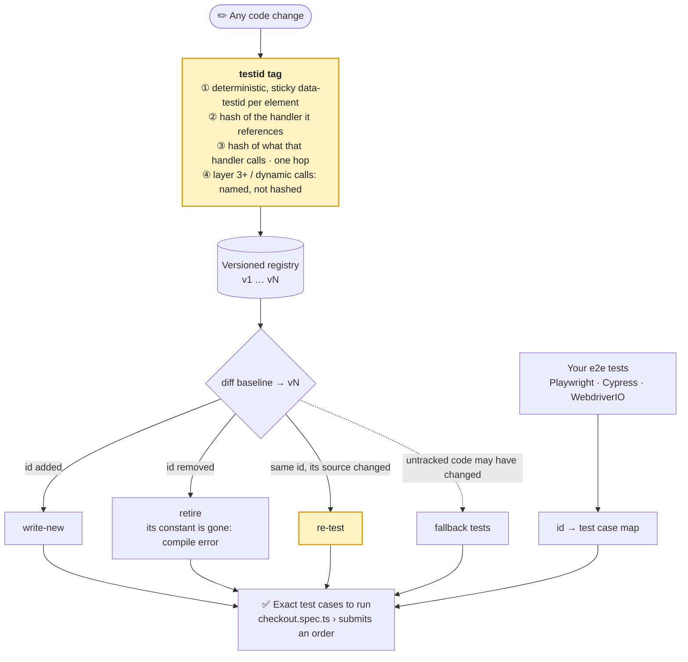

# testid-universal: Test Impact Analysis for E2E Tests

[](https://github.com/chinayangxiaowei/testid-universal/actions/workflows/ci.yml)
[](./LICENSE)

English | [简体中文](./README.zh-CN.md)

**Know which e2e tests to rerun after any code change.** testid-universal is a
framework-agnostic, build-time engine for **test impact analysis** of end-to-end suites: it
writes **deterministic `data-testid`** attributes into your Vue, React, Angular or HTML
templates, binds each test id to the source it depends on, and turns every code change into
an exact **E2E test selection** — which test cases to rerun, rewrite, or retire.

- **Test impact analysis (TIA) for e2e** — a code change maps to the exact Playwright,
  Cypress, WebdriverIO or TestCafe test cases that use the affected elements, even when no
  test id changed: handler bodies and the definitions they directly call are tracked.
- **E2E test selection in CI** — run only the affected tests on each pull request; the
  reference CI router falls back to the full suite wherever tracking cannot vouch for the
  result ([CI tutorial](docs/ci-tutorial.md)).
- **Deterministic test id generation** — stable `data-testid` values derived from semantics
  (form control, name, route, handler), never from DOM position or copy; once written they
  stay sticky across edits, so locators do not churn.
- **Fail-closed locators** — generated test id constants (TS or plain JS), so a removed
  element breaks compilation instead of a test run.



What sets it apart: an id that did **not** change still triggers a re-test when the code
behind it changes — and what it cannot see is named, never reported as safe.

## The problem

`data-testid` is the standard anchor for e2e locators, but hand-managing ids fails in two
directions:

1. **Locator decay.** Ids drift when markup changes (or are duplicated, or missing), so
   tests silently match the wrong element — or nothing.
2. **Stale tests with healthy locators.** The id still resolves, but the *behavior behind
   the element* changed (a handler body, a validator, a bound value). Nothing tells you the
   test needs to be re-run or re-written.

Solving only #1 (what most generators do) is necessary but not sufficient: **an id change
is one signal; a source-dependency change is the complementary trigger.**

## How it works

### 1. A closed signal contract (adapters can't lie)

Each framework adapter parses templates into `ElementNode[]` carrying **`RawSignals`** — a
closed, tiered schema. Adapters only map framework vocabulary into named slots
(`formControlName`/`v-model` → `form_control`, `@click` → `event_handlers`, …); the
priority policy, hashing, and diffing all live in the core and are not adapter-configurable.

| Tier | Signals | Role |
| --- | --- | --- |
| 0 | `explicit_key` (an authored `data-tid`) | absolute identity anchor |
| 1 | `form_control`, `name`, `route`, `event_handlers`, `bound_identifiers`, `html_id`, `structural` | **identity** (stable, code-wired) |
| 2 | `child_shape`, `context`, `semantic_css` | disambiguation only |
| 3 | `text`, `aria_label`, `placeholder`, `title`, …, `static_attributes` | **fingerprint only** (volatile copy) |

### 2. Identity ≠ fingerprint

- **identity** is the stable matching key, built **only from stable signals** — display
  copy is ranked last and emits an `unstable-identity` warning when it ends up as the key.
  Identity is a pure function of the element's *own* signals: adding or editing element B
  can never move element A's id.
- **fingerprint** is a rich descriptive signature over **all** signals. It is never used
  for matching — only to detect `modified` and report *which fields changed*.

### 3. Sticky ids — locators never churn

On re-tag, an element that already carries a written `data-testid` **keeps it verbatim**
(`source: 'sticky'`). Copy edits, restyles, sibling insertions — nothing moves a written
id. `--regenerate` (or deleting the attribute) is the only way to re-mint. Freshly minted
ids are guaranteed unique (group-coherent disambiguation; positional suffixes inherit
their previous slot via byte-exact fingerprint match so reordering siblings doesn't shift
incumbents).

Elements inside a loop (`v-for` / `*ngFor`) get a `loop-multiplicity` warning: one static
id is shared by every rendered instance — bind a per-item id instead
(`:data-testid="'row-' + item.id"`), which the tagger then **respects and never overwrites**.

### 4. Deterministic diff — no fuzzy matching

Snapshots are versioned in a JSON registry. `diff(v1, v2)` classifies every id exactly:
`unchanged` / `added` / `removed` / `modified` (with a field-level change list) /
`regenerated` (an id that disappeared and came back, via tombstoned provenance). There is
no similarity threshold anywhere — every signal is exact.

### 5. testID → test-case map (fail-closed)

`generateConstants(snapshot)` emits a `testIds` module (TS, or plain JS with a JSDoc
`@type {const}` when the target is `.js`). Tests import constants instead of hardcoding
strings, so a removed or renamed id **fails to compile** — never a silent runtime mismatch.
Test sources are scanned (constant refs + raw id strings) into an id → test map, and a diff
becomes a routed action list: **`write-new` / `retire` / `re-test`** — at case level by
default (`affectedTestCases`: the exact `test(...)` block), or per file (`affectedTests`).
A sticky id whose element now has a different identity is flagged **anchor drift**, so the
test's intent gets re-checked, not just re-run.

### 6. testID → source-dependency map (re-test even when the id didn't change)

For each element, the core selects the symbols it directly references (handler names,
bound-identifier roots, `v-model` targets); the adapter resolves them to their
**definition source text** (Vue: `<script setup>` declarations; React: the JSX file itself;
Angular: the component's companion `.ts`); the core hashes the text (whitespace-insensitive) into
`symbol_defs`. When a definition body changes — even with the id frozen and the markup
untouched — the diff reports `modified` with `symbol:<name>`, and the linked tests are
routed to `re-test`.

**One hop further (`dep_defs`, on by default; `tag --no-deps` turns it off).** The
definitions a referenced handler *directly uses* are hashed too — a same-file helper, an
imported function (relative paths, tsconfig/jsconfig `paths` aliases, re-export barrels
followed to the real declaration), a hook or store reached through an instance alias
(`const tasks = useTaskStore(); tasks.claimTask()` → only the `claimTask` member), and
Angular injected service methods (`this.svc.create()`). A change there reports
`modified` with `dep:<handler>><ref>` (e.g. `dep:submit>createOrder`) and routes the
linked tests to `re-test`. Only the referenced declaration/member is sliced, so editing a
sibling export does not flag.

**Honest boundary:** tracking stops one hop past the handler — what `createOrder` itself
calls (layer 3), bare packages (node_modules), and dynamic dispatch are NOT followed. A
local-looking import that cannot be resolved is printed by `tag` as UNRESOLVED (never
silently treated as unchanged). What lies beyond the hop is not hashed but **named**:
`tag` prints the BEYOND-depth dependencies (`submit>createOrder>validate`, a sibling
`this.persist()`, `(dynamic) handlers[mode]`), the registry keeps them as `dep_limited`, and
`affected` appends a "⚠ Beyond tracking depth" section listing the tests to fall back to
(or run the full suite) when such code changes — two hops tracked never reads as "safe".
Cross-file changes are only seen when the dependent file is in the `tag` run (tag the whole source tree, not just changed files). Frameworks /
adapters without the capability degrade to name-only tracking. Registries created before
symbol or dep tracking upgrade with zero noise (first run records the baseline; dep keys
are compared only when present on both sides).

## Quick start

> Step-by-step tutorial, full CLI/config/warning references, and FAQ: **[USAGE.md](./USAGE.md)**.

Not on npm yet: clone and build, then depend on the local checkout.

```bash
git clone https://github.com/chinayangxiaowei/testid-universal && (cd testid-universal && npm ci && npm run build)
npm i -D file:../testid-universal   # from your project; zero runtime deps in core
# optional peer deps, only for what you use:
npm i -D @vue/compiler-sfc          # Vue adapter
npm i -D @angular/compiler          # Angular adapter
npm i -D @babel/parser              # React adapter and one-hop dependency tracking
```

### Tag a Vue project (library)

```ts
import {
  VueAdapter, LocalTransport, JsonFileStorage, runPipeline, diffToMarkdown,
} from 'testid-universal';
import { readFileSync, writeFileSync } from 'node:fs';

const transport = new LocalTransport(new JsonFileStorage('.testids'));
const adapter = new VueAdapter(); // or new VueAdapter(VUETIFY_TAG_MAP)

const files = ['src/pages/LoginPage.vue'].map((file) => ({
  file,
  component: file.split('/').pop()!.replace('.vue', ''),
  source: readFileSync(file, 'utf8'),
}));

const result = await runPipeline(adapter, transport, files);
for (const t of result.tagged) if (t.after !== t.before) writeFileSync(t.file, t.after);

console.log(`registry version ${result.version}`);
for (const w of result.warnings) console.warn(`[${w.code}] ${w.message}`); // w.code: unstable-identity / loop-multiplicity / ...

// later, after edits + another runPipeline:
const d = await transport.diff(1, 2);
console.log(diffToMarkdown(d!));
```

Re-running is **idempotent and sticky**: tagged files are not rewritten, written ids are
never recomputed. Pass `runPipeline(..., { regenerate: true })` to force a re-mint.

### Route the diff to your tests

```ts
import { generateConstants, buildTestMap, affectedTests, affectedTestsToMarkdown } from 'testid-universal';

// 1. emit constants; commit the file; tests import { testIds } from it
writeFileSync('e2e/testids.generated.ts', generateConstants(snapshot));

// 2. map ids to the tests that reference them
const map = buildTestMap(testFiles /* {file, source}[] */, snapshot);

// 3. after a diff: which tests to write / retire / re-test
console.log(affectedTestsToMarkdown(affectedTests(diff, map)));
```

A `modified` id (markup field OR `symbol:<name>` change) routes its tests to `re-test`;
`removed` → `retire` (and the vanished constant breaks compilation); `added` → `write-new`.

### CLI (embedded)

```bash
npm run cli -- tag src/app --registry ./reg                  # HTML-like templates (default --ext .html)
npm run cli -- tag src --ext .vue --registry ./reg           # Vue SFCs (VueAdapter picked automatically)
npm run cli -- tag src --ext .jsx,.tsx --registry ./reg      # React (ReactAdapter picked automatically)
npm run cli -- tag src --ext .vue --check                    # CI gate: writes nothing, exit 1 if tagging is needed
npm run cli -- diff 1 2 --registry ./reg
npm run cli -- gen-locators --target playwright --out tests/locators --registry ./reg
npm run cli -- gen-constants --out e2e/testids.generated.ts --registry ./reg
npm run cli -- affected 1 2 --tests e2e --out-list retest.txt --registry ./reg
npm run serve            # OPTIONAL node:http backend on :7337; add --server <url> to any command
                         # (JsonFileStorage = one host; set DATABASE_URL for PostgresStorage)
```

`affected` prints the `write-new` / `retire` / `re-test` report and (with `--out-list`)
emits the file list for the runner (`--include-limited` adds the beyond-depth fallback
tests; guard an empty list — `playwright test` with no filter runs everything).
**Step-by-step CI setup: [`docs/ci-tutorial.md`](docs/ci-tutorial.md)** (copy-ready router
script + GitHub Actions workflow in `examples/ci/`); design rationale in
`docs/superpowers/specs/2026-06-11-ci-integration-design.md`.

The adapter is picked from the matched files (`.vue` → Vue, `.jsx`/`.tsx` → React, `.html`
with Angular markers such as `(click)=` / `*ngIf` → Angular, otherwise HTML);
`--adapter <html|vue|angular|react>` overrides, and mixed runs are rejected with a clear error. Embedded
and remote are interchangeable: the same `TestIdService` sits behind a `LocalTransport`
(in-process) or `HttpTransport` (REST), and calling code is identical.

### Locator generation

`gen-locators` / `generateLocators(snapshot, target)` emit ready-to-use locator files for
**Playwright** (`getByTestId`), **Cypress**, **WebdriverIO**, **Selenium (Python)**,
**TestCafe**, or **Robot Framework** (selector convention `[data-testid="<id>"]`); any
other runner can consume the framework-agnostic `gen-constants` module directly.

## What a real lifecycle looks like

| Edit | Result |
| --- | --- |
| First tag | ids minted from stable signals (`login__input--email`, `login__button--onsubmit`) |
| Change button copy "Sign in" → "Log in" | id frozen; diff: `modified { text }` — re-test only if you assert the label |
| Add a field | diff: `1 added`, nothing else moves |
| Edit `onSubmit`'s **function body** (template untouched) | ids frozen, 0 files rewritten; diff: `modified { symbol:onSubmit }` on exactly the form + button wired to it → their tests are routed to re-test |
| Edit `createOrder` in `api.js`, which `onSubmit` calls | page untouched; diff: `modified { dep:onSubmit>createOrder }` → the same tests are routed to re-test |
| Edit `validate`, which `createOrder` calls (layer 3) | no diff entry by design; `tag` names it BEYOND tracking depth and `affected` lists its tests as fallback |
| Swap the handler on a tagged button (`onClick={submit}` → `onClick={cancel}`) | id stays (sticky); diff flags **anchor drift** — the id now anchors a different action |
| Delete an element | diff: `removed`; its constant vanishes → referencing tests fail to compile; report says `retire` |
| Interactive element with no stable signal (`<button>OK</button>`) | tagged, but warned: add a `data-tid` if you need it stable |
| Copy-only presentation tag (`h1`–`h6`, `th`, `label`) | skipped by default (`skipTags`) — opt in with a `data-tid`; already-written ids stay sticky |
| Element inside `v-for` | `loop-multiplicity` warning + the documented fix; a bound `:data-testid` is respected, never overwritten |

## Architecture

| Layer | Files | Framework-aware? |
| --- | --- | --- |
| Adapters | `src/adapters/{contract,html,vue,angular,react}.ts` | **yes — only here** |
| Core engine | `src/core/{types,signals,identity,fingerprint,classify,format,sourcedeps,engine}.ts` | no (pure) |
| Registry | `src/registry/{storage,registry,diff,postgres}.ts` | no |
| Locators & constants | `src/locators/` | no |
| Test map | `src/testmap/` | no |
| Backend | `src/server/` (`TestIdService` + `node:http` shell) | no |
| Client | `src/client/{transport,pipeline,deps}.ts` (`deps` = one-hop JS/TS resolver) | no |
| CLI | `src/cli.ts` | no |

Dependencies point downward; the core depends on nothing but `node:crypto`. A new
framework = one adapter implementing `parse`, `write`, and optionally
`resolveSymbolDefs` (direct symbol definitions) and `scriptContext` (one-hop tracking). Adapters today: **Vue**, **Angular** (AST-backed; Angular templates are content-sniffed
automatically since they share the `.html` extension) and **React** (JSX/TSX via
`@babel/parser`; one JSX source node renders N runtime instances, so identity is built
from props only and instances share one id), plus **HTML** (hand-written quote-aware scanner).

## Invariants

1. Identity excludes display copy; copy as key is a warned last resort.
2. `static_attributes` feeds the fingerprint only — never identity.
3. An id is a pure function of the element's own signals; no randomness, no counters.
4. Every emitted id is unique within a parse.
5. Writes are idempotent and minimally invasive: only the attribute is inserted (a tag's own
   existing testid is replaced), so removing it restores the source byte-for-byte.
6. A written id is sticky; only `--regenerate` re-mints.
7. Adapters fill signal slots and resolve definition *text*; policy, hashing, and diffing
   are core-owned.

## Known limitations

- Truly identical signal-less siblings disambiguate by document order (information-
  theoretically unavoidable) — the warning recommends an explicit `data-tid`.
- Source-dependency tracking follows direct references **plus one hop** (`dep_defs`, no
  call graph); Vue options API / plain `<script>` resolve name-only.
- Concurrent writers never lose work: every storage's `save` is a compare-and-swap on the
  base version (a stale writer gets `RegistryConflictError`; `tag` rebases and retries, so
  concurrent tags land as consecutive versions). `JsonFileStorage` serializes writers with
  a `<registry>/.lock` file and writes atomically (temp + rename) — safe for parallel
  processes on **one host / local filesystem** (not network filesystems), no auth. A lock
  older than 30s is treated as a crashed writer and reclaimed. For a shared multi-host
  service use `PostgresStorage` (row lock; pass a `pg.Pool` so it gets real transactions).
- The HTML adapter is a hand-written, quote-aware scanner — not a spec parser.
- Write-back is guarded by a seeded property test (`test/adapters/write-fuzz.test.ts`):
  random valid JSX — nesting, JSX in props, ternaries, spreads, comments and strings full
  of quotes/braces, pre-existing ids — must still parse, restore byte-exactly when the
  inserted ids are removed, never carry two ids on one element, and re-tag as a fixed
  point (`FUZZ_N` / `FUZZ_SEED` widen or pin a run). The React/Vue/Angular adapters hand
  the writer the exact AST ranges of a tag's own existing testid; only HTML lexes.

## Development

```bash
npm test            # vitest (291 tests)
npm run typecheck   # tsc --noEmit
npm run build       # tsc
npm run demo        # HTML end-to-end demo
npm run demo:vue    # .vue → tag → diff → Playwright locators
```

Design docs live in `docs/superpowers/specs/` (identity model; sticky ids + dual-map);
empirical findings in `docs/findings/`. The project began as a clean-room distillation of
the build-time Angular tagger idea (`spachtholz/TestID-Generator`) and has since diverged:
sticky ids, exact-identity diffing, the fail-closed test map, and definition-level source
tracking are original to this codebase.
